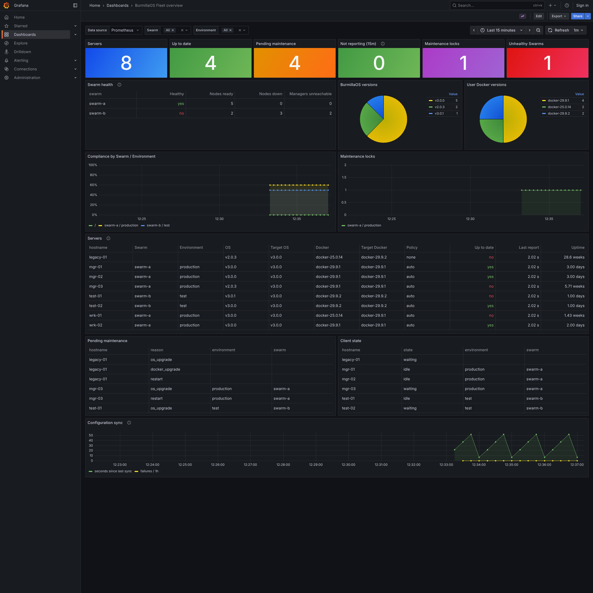

# os-fleet-manager

Singleton Fleet Manager service to control large amounts of BurmillaOS installations.

It is the successor of the RancherOS `os-subscriber` idea, built for servers
which are part of a Docker Swarm:

* The desired state of the fleet lives in a **private Git repository**
  (GitHub or Azure DevOps), so every change is reviewed and versioned.
* Target **BurmillaOS** and **User Docker** versions are set per **Swarm +
  Environment** (and can be overridden per server).
* Every server has a **maintenance window**. Upgrades and **scheduled
  restarts** only happen inside it.
* Servers take a **maintenance lock** before they upgrade or restart. Locks are
  only handed out while the **whole Swarm is healthy**, including every
  service running all its tasks with its target configuration, and are only released
  once the server is back and the Swarm is healthy again, so a rollout never
  takes down more nodes than you allow and stops on the first broken node.
* Optional htpasswd-style **authentication per Swarm + Environment**.
* Servers report back their state; Fleet Manager publishes it as
  **Prometheus metrics**, with example **Grafana dashboards**.

The client side is the optional `fleet-client` system service in
[os-services](https://github.com/burmilla/os-services) (`images/20-fleetclient`).

```
 private Git repo ──(git fetch every minute)──► Fleet Manager ◄── Prometheus ◄── Grafana
   fleet.yml                                     ▲      │
                                     report/lock │      │ target versions, window, restart
                                                 │      ▼
                                        fleet-client on every BurmillaOS server
```

## Fleet configuration

`fleet.yml` in the root of the configuration repository. Settings are
inherited `defaults` < `swarms.<swarm>` < `swarms.<swarm>.environments.<env>`
< `servers.<hostname>`. See [examples/fleet-config/fleet.yml](examples/fleet-config/fleet.yml).

| Setting                      | Description |
|------------------------------|-------------|
| `os_image`                   | BurmillaOS image repository, default `burmilla/os` |
| `os_version`                 | Target BurmillaOS version (image tag), e.g. `v3.0.0`. Empty = not managed |
| `docker_version`             | Target User Docker engine as listed by `ros engine list`, e.g. `docker-29.9.2`. Empty = not managed |
| `upgrade_policy`             | `auto` (apply in maintenance window), `download` (pre-pull only) or `none` (report only, the default) |
| `maintenance_window`         | `days` (`mon`..`sun`, empty = every day), `start` (`HH:MM`), `duration` (Go duration) and `timezone` (IANA, default UTC). No window = any time |
| `max_concurrent_maintenance` | How many servers of one Swarm + Environment may be in maintenance at once, default 1 |
| `max_uptime`                 | Scheduled restart when uptime exceeds this, e.g. `30d` or `720h` |
| `restart_after`              | One-off restart: servers booted before this RFC 3339 time restart in their next window |
| `check_interval`             | How often clients check in, default `5m` |
| `ssh.authorized_keys`        | SSH public keys of the `rancher` and `docker` users managed by fleet-client. The list of the most specific level wins. `[]` removes all managed keys, unset = not managed |
| `ssh.password_authentication`| `true` / `false` enables or disables password logins in sshd. Unset = not managed |
| `ssh.disable_after_boot`     | Hardening: stop sshd once the server has been up this long (e.g. `10m`) and no SSH session is active. `0` = enable sshd, unset = not managed |

A `servers:` entry can also set `swarm` and `environment`, which then win
over what the client was configured with.

### Splitting the configuration per team

Swarms can be kept in their own files next to `fleet.yml`, so the parts can
be delegated to different teams with CODEOWNERS (GitHub) or path-based
required reviewers (Azure DevOps) and branch protection:

```
fleet.yml                          defaults and anything not delegated (platform team)
swarms/swarm-a.yml                 Swarm settings, environments and servers (team A)
swarms/swarm-a/production.yml      one environment and its servers (e.g. production ops)
```

* `swarms/<swarm>.yml` has the same fields as a `swarms.<swarm>` entry plus
  `servers:`; those servers belong to that Swarm.
* `swarms/<swarm>/<environment>.yml` has the fields of an environment
  (including `htpasswd`) plus `servers:`; those servers belong to that Swarm
  environment.
* A file cannot move a server to another Swarm or environment, and a Swarm,
  environment or server may be defined only once across all files, so one
  team cannot override what another team's file defines.
* Server entries need a delegation in `fleet.yml`: `delegation.<swarm>.servers`
  lists the hostname patterns (`path.Match` syntax) which the files of that
  Swarm may list. Without it they cannot list any server, so a team cannot
  pull another team's server into its Swarm. Servers not listed anywhere still
  follow the Swarm and Environment configured on them.

  ```yaml
  # fleet.yml, owned by the platform team
  delegation:
    swarm-a:
      servers: ["swarm-a-*"]
  ```
* If any file is invalid, Fleet Manager keeps serving the previous
  configuration (`burmilla_fleet_config_sync_success` is 0). Run
  `fleet-manager validate fleet.yml` in CI of the configuration repository
  so broken changes are caught before merge.

See [examples/fleet-config](examples/fleet-config) for a split configuration
with [CODEOWNERS](examples/fleet-config/CODEOWNERS) and a
[validation workflow](examples/fleet-config/.github/workflows/validate.yml).

### SSH access

fleet-client applies `ssh` settings on every check-in, without a maintenance
lock, because they do not interrupt running workloads:

* `authorized_keys` are written to a block marked
  `# BEGIN burmilla-fleet-manager` / `# END burmilla-fleet-manager` in
  `~/.ssh/authorized_keys` of the `rancher` and `docker` users. Keys outside
  of that block (cloud-config `ssh_authorized_keys`, added by hand) are left
  alone, so removing a key from `fleet.yml` removes it only from the block.
* `password_authentication` is written to
  `/etc/ssh/sshd_config.d/50-burmilla-fleet.conf` in the console container
  and sshd is reloaded. Open sessions are kept.

* `disable_after_boot` stops sshd of the console (`ros console sshd
  disable --if-idle`) once the server has been up that long and no SSH
  connection is established. While a session is open fleet-client checks
  again every minute. sshd starts again after every boot, so SSH is
  available for the same period after a reboot; `0` enables sshd right away
  on running servers (console access works as well). Needs a BurmillaOS
  version with `ros console sshd`.

Make sure servers have working keys before disabling passwords. The applied
state is reported back and exposed as `burmilla_fleet_server_ssh_in_sync`.

```yaml
defaults:
  ssh:
    authorized_keys:
      - ssh-ed25519 AAAA... alice@example.com
swarms:
  swarm-a:
    environments:
      production:
        ssh:
          password_authentication: false
```

### Authentication

The API can stay open, but each Swarm + Environment can be protected with
htpasswd-style HTTP Basic authentication:

```yaml
swarms:
  swarm-a:
    environments:
      production:
        htpasswd:
          - "swarm-a-production:$2y$05$..."   # htpasswd -nbB swarm-a-production 'password'
```

* Only bcrypt entries are accepted, and a user name can be used by one Swarm +
  Environment only. Several entries allow rotating passwords.
* Credentials bind the client: with them a server always acts in their Swarm +
  Environment, whatever it claims.
* A server that belongs to a protected Swarm + Environment (through `servers:`
  or its earlier reports) must use that one's credentials for config, reports
  and locks, so another environment's servers cannot report for it or take its
  maintenance locks. To move such a server, list it under `servers:`.
* Unprotected Swarm + Environments, and `/api/v1/servers`, `/api/v1/swarms`
  and `/metrics`, stay open.

Basic authentication sends the password with every request, so use TLS:
set `FLEET_TLS_CERT` / `FLEET_TLS_KEY` or put Fleet Manager behind a TLS
reverse proxy.

What it protects and what not:

* The bcrypt hashes can be kept in the configuration repository, like
  `/etc/shadow` entries: they cannot be reversed, only guessed. Use long
  random passwords (e.g. `openssl rand -base64 24`), which make guessing
  infeasible even for someone who can read the repository.
* The password is shared by all servers of the Swarm + Environment and stored
  on each of them (`rancher.environment.FLEET_PASSWORD`). Whoever has root on
  one of them can act as any server of that environment: send false reports
  or take its maintenance locks. It cannot reach other environments.
* It authenticates servers towards Fleet Manager, not Fleet Manager towards
  servers: use HTTPS (and `FLEET_CA_CERT` for a private CA) so clients only
  take configuration from the real Fleet Manager.
* Configuration itself is not secret (`/api/v1/servers` stays open); do not
  put secrets into `fleet.yml`.

### Maintenance lock and Swarm health

Before an upgrade or restart a client asks for a maintenance lock. It is granted
only when the server is inside its window, a slot is free in its Swarm +
Environment, and the whole Swarm is healthy: every other member (that does not
hold a lock) has reported recently, is `active` in the Swarm and not in error,
and the freshest manager report shows no more nodes down or managers
unreachable than there are servers in maintenance, and **every service runs all
of its desired tasks, healthy and with its target configuration** (no update in
progress, paused or rolling back; a global service may miss the tasks of the
servers in maintenance), and **every local container with a restart policy**
(`always`, `unless-stopped`, `on-failure`; not Swarm tasks) on those servers
runs and, with a health check, is healthy. Managers additionally must not break
the Raft quorum. Servers outside of a Swarm only need their own local
containers to be ready. The lock is released when the server reports the target
state **and** its local containers and the Swarm are healthy again. Label a
container `io.burmilla.fleet.ignore=true` to leave it out of the check. Details are in
[docs/api.md](docs/api.md); `GET /api/v1/swarms` shows why a Swarm is blocked.

Because of this, run `fleet-client` on all members of a Swarm, managers
included.

## Running

```bash
docker run -d --name fleet-manager -p 8080:8080 -v fleet-data:/data \
  -e FLEET_GIT_URL=https://github.com/example/fleet-config.git \
  -e FLEET_GIT_TOKEN=github_pat_... \
  burmilla/os-fleet-manager:v1.0.0
```

For Docker Swarm see [deploy/docker-stack.yml](deploy/docker-stack.yml).
Run a **single replica** with a persistent `/data` volume: the last reports
and the maintenance locks are stored there (`reports.json`, `locks.json`), so
a restart or a reschedule of the service keeps the locks. A lock is only
granted once it has been written to disk.

| Variable               | Default      | Description |
|------------------------|--------------|-------------|
| `FLEET_GIT_URL`        |              | HTTPS URL of the configuration repository |
| `FLEET_GIT_BRANCH`     | `main`       | Branch to follow |
| `FLEET_GIT_TOKEN`      |              | Personal access token (read-only access to the repository is enough) |
| `FLEET_GIT_TOKEN_FILE` |              | Read the token from a file, e.g. a Docker secret |
| `FLEET_GIT_USERNAME`   | `git`        | User name sent with the token |
| `FLEET_CONFIG_FILE`    | `fleet.yml`  | Path of the configuration inside the repository; the `swarms` directory is read next to it |
| `FLEET_CONFIG_DIR`     |              | Use a local directory instead of Git |
| `FLEET_SYNC_INTERVAL`  | `1m`         | How often the repository is fetched |
| `FLEET_LOCK_TTL`       | `30m`        | Maintenance lock lifetime |
| `FLEET_DATA_DIR`       | `/data`      | Repository checkout, last reports and maintenance locks |
| `FLEET_LISTEN`         | `:8080`      | Listen address |
| `FLEET_TLS_CERT`, `FLEET_TLS_KEY` |   | Serve HTTPS with this certificate and key |

Tokens:

* **GitHub**: a fine-grained personal access token with *Contents: read-only*
  on the configuration repository.
* **Azure DevOps**: a PAT with *Code (Read)* scope. URL format
  `https://dev.azure.com/<org>/<project>/_git/<repo>`.

The token is passed to git as an HTTP header through the environment and is
never written to disk. If a sync or the new configuration is invalid, the last
good configuration stays active and `burmilla_fleet_config_sync_success` drops
to 0.

## API

The API only serves versions and maintenance windows, so authentication is
optional, per Swarm + Environment (see above). Full contract:
[docs/api.md](docs/api.md).

| Endpoint                            | Use |
|-------------------------------------|-----|
| `GET /api/v1/config?hostname=…`     | Desired state of a server |
| `POST /api/v1/report`               | Client status report, returns the desired state |
| `POST /api/v1/maintenance/lock`     | Take a maintenance lock |
| `DELETE /api/v1/maintenance/lock`   | Release a lock manually |
| `GET /api/v1/servers`               | All servers with reported and desired state |
| `GET /api/v1/swarms`                | Swarm health as used for lock decisions |
| `GET /metrics`                      | Prometheus metrics |
| `GET /healthz`                      | Health check |

## Metrics and dashboards

| Metric | Labels |
|--------|--------|
| `burmilla_fleet_server_info` | hostname, swarm, environment, os_version, docker_version, kernel_version, client_version |
| `burmilla_fleet_server_desired_info` | hostname, swarm, environment, os_version, docker_version, upgrade_policy |
| `burmilla_fleet_server_up_to_date` | hostname, swarm, environment |
| `burmilla_fleet_server_maintenance_required` | hostname, swarm, environment, reason |
| `burmilla_fleet_server_restart_required` | hostname, swarm, environment |
| `burmilla_fleet_server_maintenance_window_active` | hostname, swarm, environment |
| `burmilla_fleet_server_maintenance_lock_held` | hostname, swarm, environment, reason |
| `burmilla_fleet_server_state` | hostname, swarm, environment, state |
| `burmilla_fleet_server_last_report_timestamp_seconds` | hostname, swarm, environment (0 = never reported) |
| `burmilla_fleet_server_boot_timestamp_seconds` | hostname, swarm, environment |
| `burmilla_fleet_server_containers` | hostname, swarm, environment, state (local containers with a restart policy: ready / not_ready) |
| `burmilla_fleet_server_container_not_ready` | hostname, swarm, environment, container, state, health |
| `burmilla_fleet_server_ssh_in_sync` | hostname, swarm, environment (managed SSH keys and password setting applied) |
| `burmilla_fleet_server_ssh_password_authentication` | hostname, swarm, environment (sshd accepts passwords) |
| `burmilla_fleet_server_ssh_disabled` | hostname, swarm, environment (sshd disabled by `disable_after_boot`) |
| `burmilla_fleet_maintenance_locks` | swarm, environment |
| `burmilla_fleet_swarm_healthy` | swarm |
| `burmilla_fleet_swarm_nodes` / `burmilla_fleet_swarm_managers` / `burmilla_fleet_swarm_services` | swarm, state |
| `burmilla_fleet_swarm_service_running_tasks` / `burmilla_fleet_swarm_service_desired_tasks` | swarm, service, mode, update_state (services which are not ready) |
| `burmilla_fleet_config_info` | revision |
| `burmilla_fleet_config_last_sync_timestamp_seconds`, `burmilla_fleet_config_sync_success`, `burmilla_fleet_config_sync_failures_total` | |

Scrape config example: [deploy/prometheus.yml](deploy/prometheus.yml).
Grafana dashboards to import: [grafana/fleet-overview.json](grafana/fleet-overview.json)
(whole fleet) and [grafana/fleet-server.json](grafana/fleet-server.json) (one server).



## Development

```bash
go test ./...
docker build -t burmilla/os-fleet-manager:dev .
FLEET_CONFIG_DIR=examples/fleet-config FLEET_DATA_DIR=/tmp/fleet go run .
```

## License

Copyright (c) 2026 Project Burmilla

Licensed under the Apache License, Version 2.0 (the "License");
you may not use this file except in compliance with the License.
You may obtain a copy of the License at

[http://www.apache.org/licenses/LICENSE-2.0](http://www.apache.org/licenses/LICENSE-2.0)

Unless required by applicable law or agreed to in writing, software
distributed under the License is distributed on an "AS IS" BASIS,
WITHOUT WARRANTIES OR CONDITIONS OF ANY KIND, either express or implied.
See the License for the specific language governing permissions and
limitations under the License.
